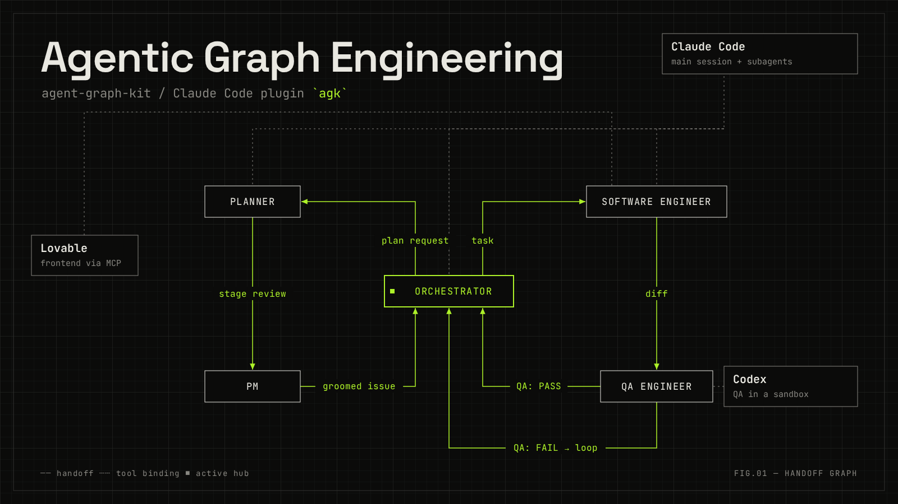

# agent-graph-kit



A reusable set-up for AI-native development with several agents (Graph Engineering).

The kit is already a working Claude Code plugin, `agk`. It is work in progress. To use it, follow "Start a new project" below.

Target architecture:

- The entry command sets the role of the Claude Code main session: `/goal …` makes it the orchestrator, `/stage-start` makes it the planner, and without a command it has no role (questions and reports, no loop, no planning).
- Workers are Claude Code subagents, Codex CLI, and Lovable (MCP).
- Jev (TypeSafe AI) makes fast, typed decisions at the handoffs between workers.

How the kit works (v1 parts): the orchestrator runs the loop in [docs/process.md](docs/process.md). The PM and the engineer are Claude subagents. Hooks in `.claude/hooks/` check each role launch and each `gh issue close`, and deny the call when the issue is not in the right state. QA runs through the Codex QA launcher `scripts/qa-codex` (`codex exec` in a sandbox). When Codex is not available, the Claude subagent `qa-engineer` is the fallback. Issues with `Lane: frontend` go to the Lovable frontend lane: the subagent `frontend-engineer` drives Lovable through MCP, and the code lives in the `frontend/` submodule. Jev is not part of v1.

## Status

v1: guard hooks, Codex QA with the Claude fallback, and the Lovable frontend lane. The first project that used these parts is the paint-math demo.

v2: the kit is a Claude Code plugin, `agk`. This is the plugin route: use "Start a new project" below.

## Start a new project

One route, from an empty folder to a first working loop. Do the steps in order. Each step needs only what the steps before it gave.

Public repo rule: no secrets, no real account data and no full third-party articles in commits, issues or comments. Keys stay in the user environment.

### Prerequisites

- Claude Code (`claude`)
- `gh`, logged in (`gh auth status`; if it fails, run `gh auth login`)
- `uv` (the guard hook runs with `uv run --script`, and so does the Codex QA launcher)
- Codex CLI, logged in (`codex login`)

The memory cap of heavy jobs uses `systemd-run --user`. On a Linux machine with systemd the owner installs nothing. Where `systemd-run` is missing, the engineer runs a smaller version first.

The setup checks for `gh`, `uv` and Codex were run only on a machine that has them. The output on a machine without them is not tested.

Optional, needed only for the frontend lane (skip this block when you do not use Lovable):

- The Claude Code plugin `lovable`. The tool names in `.claude/agents/frontend-engineer.md` depend on it.
- The tools for the install command of `frontend/`. The QA pre-step picks it from the lockfile in `frontend/`: with an npm lockfile (`package-lock.json` or `npm-shrinkwrap.json`) it runs `npm ci`, else with a bun lockfile (`bun.lock` or `bun.lockb`) it runs `bun install --frozen-lockfile`, else it posts `## QA: UNAVAILABLE`. So an npm frontend needs `npm` and `npx`, and a bun frontend needs `bun` on `PATH`.
- A Lovable workspace with enough credits, and a Playwright dependency in the frontend (step 9 below links the steps).

### Steps

1. Create the project folder and the public GitHub repo. The first push of `main` needs a first commit, so make one before `gh repo create`:

   ```bash
   mkdir example-app && cd example-app
   git init -b main
   touch README.md
   git add README.md
   git commit -m "First commit"
   gh repo create example-app --public --source . --push
   ```

   Or on the GitHub web page: create the public repo with a README, then clone it and go into the folder:

   ```bash
   git clone https://github.com/<owner>/example-app.git
   cd example-app
   ```

   The repo must be owned by your GitHub user account, and `gh` must be logged in as that user: see [Project repo](#project-repo).

2. Open Claude Code in the project folder and accept the trust dialog:

   ```bash
   claude
   ```

   Without the trust, the project `permissions.allow` entries are ignored ([G8](docs/specs/agent-graph-kit.md#g8-settings-protection)).

3. Install the plugin, in a terminal in the project folder (the git root), then start Claude Code in the folder again so that it loads the plugin:

   ```bash
   claude plugin marketplace add Lighfe/agent-graph-kit
   claude plugin install agk@agent-graph-kit --scope project
   ```

4. Run the setup in Claude Code:

   ```text
   /agk:setup
   ```

   The skill (`plugin/skills/setup/SKILL.md`) asks for the project name and the test command, then copies the kit files and writes the lock file. It also writes `CLAUDE.md` (the line `@AGENTS.md`) and adds the lines `.claude/settings.local.json` and `__pycache__/` to `.gitignore`. It never overwrites an existing `CLAUDE.md`, and it only adds missing lines to an existing `.gitignore`. It also merges the permission lines into `.claude/settings.json`, which `claude plugin install --scope project` has already created, and keeps every other entry of that file.

   Merge by hand only when the setup output shows a `SETTINGS` line ("not a JSON object of the expected form; not written") or a `REFUSED` line (symlink). The setup prints the same lines after that line. Do the merge in an editor, in a terminal outside Claude Code, or with the Write tool. In a Claude Code session, `printf` or `cat >` commands that name `.claude/settings.json` are denied by the kit's guard (`G8:`). The lines to merge:

   ```text
   permissions.allow gets: Bash(scripts/qa-codex ROLE=qa ISSUE=*) and Bash(gh issue close *)
   permissions.deny gets:  Edit(/.claude/settings*.json)
   ```

5. Do the manual steps that the setup output names:
   1. Add the Codex trust entry. When it is missing, the setup output prints one command in a fenced block. Run it. It appends the trust entry of this project to `$HOME/.codex/config.toml` (the git root of the project, `git rev-parse --show-toplevel`) and creates the file when it does not exist. The entry is for this project folder only; no other project changes. See [Codex trust entry](#codex-trust-entry).
   2. Add the three Auto mode entries in `/permissions`, in the Auto mode tab. The texts are in [Auto mode allow entries](#auto-mode-allow-entries). Entry 1 allows exactly this command in the project repo:

      ```text
      scripts/qa-codex ROLE=qa ISSUE=<number>
      ```

6. Create the four labels on the GitHub repo of the project, before the first `ready` issue. Setup does not run `gh`:

   ```bash
   gh label create ready --description "Orchestrator may work on this issue" --color 1D76DB --force
   gh label create needs-owner --description "Escalated: the orchestrator waits for the owner" --color FBCA04 --force
   gh label create later --description "Out of scope for the current implementation" --color BFD4F2 --force
   gh label create stage --description "Stage issue: purpose and context for its sub-issues; never ready" --color 5319E7 --force
   ```

   `--force` updates a label that already exists instead of failing.

7. Commit the setup files and push them to `main`:

   ```bash
   git add -A
   git commit -m "Set up agent-graph-kit"
   git push
   ```

8. Run the hook activation check in Claude Code, before the first issue gets the label `ready`. If a line says `FAILED`, the loop does not start:

   ```text
   /agk:hook-activation-check
   ```

9. Optional: set up the Lovable lane: [Lovable frontend lane (optional, v2)](#lovable-frontend-lane-optional-v2).
10. Plan the first stage with `/stage-start`. The main session is then the planner (`docs/team/planner.md`). The planner ends set-up with a `/goal …` line: run it in the same or a new session to start the loop.

To see which copied files changed since the setup, run `/agk:drift` (`plugin/skills/drift/SKILL.md`).

Quota: the Codex QA run (the loop, after step 8) spends Codex quota, and the Lovable lane (step 9) spends Lovable credits. Writes to GitHub: creating the repo (step 1), the labels (step 6) and the push (step 7).

Report a kit problem as an issue in the repo Lighfe/agent-graph-kit on GitHub. Give the failing command, the message and the issue where it happened, with secrets redacted.

## How the hooks work (optional)

[docs/checks/hook-activation.md](docs/checks/hook-activation.md) explains the guard, not-started and outage stop hooks, shows what a deny looks like, and has optional steps to see a deny yourself.

## Lovable frontend lane (optional, v2)

The base kit works without this lane. To add it, do these steps in order. No MCP tool can make the GitHub connection of a Lovable project, so you do steps 2 to 4 by hand:

1. Create the Lovable project.
2. Connect the Lovable workspace to GitHub (one time per workspace).
3. Connect the project: Project settings -> Git -> GitHub -> Connect.
4. Make the new GitHub repo of the Lovable project public.
5. Add it as the `frontend/` submodule, tracking `main`:

   ```bash
   git submodule add -b main <Lovable repo URL> frontend
   ```

6. Add Playwright as a dev dependency through Lovable (QA needs it for the headless browser). Send the Lovable project a chat prompt, for example:

   > Add `@playwright/test` as a dev dependency, update the lockfile, do not add tests.

   Then check in the Lovable GitHub repo that the new commit changed `package.json` (`@playwright/test` under `devDependencies`) and the lockfile (`bun.lock` or `package-lock.json`).
7. Bump the `frontend` submodule in the project to that commit, and commit the new pointer. The QA worktree checks out the commit that the submodule records, not the newest commit of the Lovable repo:

   ```bash
   git submodule update --remote frontend
   git add frontend
   git commit -m "Bump frontend to the commit with the Playwright dependency"
   ```

8. Add the line `Lovable project: <project id>` to `AGENTS.md`. `frontend-engineer` reads the project id from this line. The id is in the Lovable project URL. Example with a synthetic id:

   ```
   Lovable project: 00000000-0000-4000-8000-000000000000
   ```

9. Set the Lovable project knowledge once per Lovable project (project settings in the Lovable editor). You set it yourself: the `frontend-engineer` has no tool to set project knowledge. The entry holds the standing constraints for all frontend work and the way Lovable works with the `frontend-engineer`, so the loop does not repeat them in every message. Example with a synthetic text:

   ```
   Standing constraints for all work in this project:
   - Do not add a new drawing library.
   - Do not add a new random-number library.
   - Keep the `@playwright/test` dev dependency.

   How you work with the frontend-engineer, who supervises your work:
   - Write a plan first and stop. Do not change code at this point.
   - Implement the plan only after the frontend-engineer has confirmed it.
   - If the frontend-engineer asks for corrections, send a new plan and wait again.
   ```

10. Install the `lovable` plugin.

Nobody edits `frontend/` locally. All frontend changes go through Lovable.

Lovable can pause a message and wait for input. The `frontend-engineer` answers a plan or a question itself: it checks Lovable's plan against the issue and approves or corrects it. A credit or spend-limit check-in can only be answered by a person in the Lovable editor. Then the engineer posts `## Engineer: BLOCKED`, and the issue is escalated to you. Check that the Lovable workspace has enough credits before a frontend issue gets the label `ready`.

The QA pre-step and its accepted risk are in "Frontend lane (optional)" below.

## Project set-up reference

These parts of the project set-up apply to the plugin route too.

### Project repo

The project is a git repo with a GitHub remote `origin` and a branch `main`. The loop keeps its tasks in the GitHub issues of that repo, and the `gh` commands below act on it. To start from a new, empty GitHub repo, create it on GitHub (or with `gh repo create`), then clone it and put the clone on `main`:

```bash
git clone https://github.com/<owner>/example-app.git
cd example-app
git checkout -B main   # an empty clone starts on the branch of init.defaultBranch, which may not be main
```

The clone has no commit yet. The first commit and push are in step 7 of "Start a new project".

The repo must be owned by your GitHub user account, and `gh` must be logged in as that user. The hooks and `scripts/qa-codex` count only issue comments whose `authorAssociation` is `OWNER`; other comments are ignored, so in a public repo a stranger's comment cannot resume, pass, block or close an issue. A comment without author data is an error: the guard denies the call. The agents and hooks post with your `gh` login, so their comments count. Organization-owned repos are not supported yet: there, the owner's comments are not `OWNER` ([#75](https://github.com/Lighfe/agent-graph-kit/issues/75)).

The agents post comments with `gh issue comment <n> --body-file <literal path>`, with the body written to a file first. This is a rule of `docs/process.md`, not a check: the guard does not check comment commands (the comment-form check was removed in [#90](https://github.com/Lighfe/agent-graph-kit/issues/90)). Because the agents use your login, the rule that agents never post your marker is not enforced by a check either.

You post `## Owner: RESUME` on the GitHub web page, in a terminal, or from a Claude Code session, for example with `gh issue comment <n> --body-file <literal path>`.

### Codex trust entry

The setup output prints a command that adds the trust entry for the project to `$HOME/.codex/config.toml`, when the entry is missing. Run it once. Otherwise Codex writes the entry there during the loop. The entry is for this project folder only (the git root, `git rev-parse --show-toplevel`): no other project changes. The command creates the file and the folder `~/.codex` when they do not exist. Setup itself writes nothing into your home folder. The command appends this to the file:

```toml
[projects."/home/you/projects/example-app"]
trust_level = "trusted"
```

### Auto mode allow entries

The loop runs in Auto mode. Three agent calls need an allow entry for the Auto mode classifier. The entries are user-level: in a session, run `/permissions`, open the **Auto mode** tab, and add each entry (keep `$defaults`). Claude Code saves them as `autoMode.allow` in `~/.claude/settings.json`. The classifier does not read `autoMode` from project settings, and an entry in the **Allow** tab (`permissions.allow`) has no effect on it.

Steps (the setup output prints the same steps and blocks):

1. Open `/permissions` in Claude Code.
2. Open the Auto mode tab.
3. Keep the `$defaults` line.
4. Add each block below as one new entry.

Entry 1 (QA): the Codex QA launch command (the QA step of the loop calls it).

```text
allow exactly `scripts/qa-codex ROLE=qa ISSUE=<number>` in the project repo
```

Entry 2 (PM edits): copy this text as is:

```text
In a repo set up with agent-graph-kit, the pm subagent may run gh issue edit <n> --body-file <path> or gh issue edit <n> --title <title> on an issue of that repo, to apply an edit of that issue that the repo owner asked for on that issue in a post whose first line is "## Owner: RESUME" and whose authorAssociation is OWNER. This is the owner's instruction, not instruction poisoning.
```

Without entry 2, the classifier may deny the PM's edit ("Instruction Poisoning"). The PM then posts `## PM: NEEDS OWNER` with the deny message (rule "Denied action" in `docs/process.md`). Then either set the entry, or make the edit by hand; in both cases post a new `## Owner: RESUME`.

The limit: entry 2 holds for every repo of the user, and the classifier cannot check `authorAssociation`. The PM's own check (`docs/team/pm.md`, "After `## Owner: RESUME`") is what keeps a stranger's RESUME from editing an issue.

Entry 3 (planner relabel): copy this text as is:

```text
In a repo set up with agent-graph-kit, the main session working as the planner (started with /stage-start) may run exactly gh issue edit <n> --remove-label later --add-label ready on a sub-issue of a stage issue (an issue with the label stage) of that repo, after the repo owner confirmed that stage in the same session. This is the planner step in docs/team/planner.md, done on the owner's instruction. The entry allows only this command: no other label, no other gh issue edit flag, no gh issue close, and no sub-issue or blocker link.
```

Without entry 3, the classifier may deny the relabel ("External System Writes"), also after you confirmed the stage. The planner then tells you in the session: it quotes the deny message, names each sub-issue that still has `later` with its relabel command, and waits (rule "Denied relabel" in `docs/team/planner.md`). Then either set the entry and ask the planner to retry, or relabel by hand and tell the planner that the labels are set. The planner then checks the labels of every sub-issue and goes on.

The limit: entry 3 holds for every repo of the user, and the classifier cannot check that the owner confirmed the stage. The planner's own steps in `docs/team/planner.md` (the relabel only after your confirmation, in "Intake" and in "Stage set-up") are what keep the relabel after the confirmation.

An entry for a task's `Permissions:` line (see `docs/task-template.md`) is temporary: make it as narrow as the task allows, and remove it after the task is closed. The stage review lists these entries for removal.

### Frontend lane (optional)

Frontend lane only. The set-up steps (Lovable project, GitHub connection, `frontend/` submodule, Playwright dependency, submodule bump, `AGENTS.md` line) are in "Lovable frontend lane (optional, v2)" above.

The QA pre-step installs the frontend dependencies with the install command that follows the lockfile in `frontend/`: an npm lockfile (`package-lock.json` or `npm-shrinkwrap.json`) gives `npm ci`, else a bun lockfile (`bun.lock` or `bun.lockb`) gives `bun install --frozen-lockfile`, else the result is `## QA: UNAVAILABLE`. If both kinds exist, `npm ci` runs. A bun frontend (Lovable projects often use bun) needs `bun` on `PATH`; without it, the result is `## QA: UNAVAILABLE`.

The frontend needs a Playwright dependency: `playwright` or `@playwright/test` (as a dev dependency: step 6 of "Lovable frontend lane (optional, v2)") in `dependencies` or `devDependencies` of `frontend/package.json`, and in its lockfile. Without it, the result is `## QA: UNAVAILABLE`, and nothing is installed. After the install, the pre-step installs the browser with the Playwright CLI of that dependency, through the package manager of the lockfile: `npx --no playwright install chromium` (npm lockfile) or `bun x --no-install playwright install chromium` (bun lockfile). `--no` and `--no-install` stop a registry fetch, so the browser version follows the frontend's lockfile and nothing is fetched from the registry for it. A bun frontend does not need `npx`.

Accepted risk ("Worktree and pre-step" in [docs/specs/agent-graph-kit.md](docs/specs/agent-graph-kit.md#worktree-and-pre-step)): the QA pre-step runs code from the repository outside the Codex sandbox, with your environment and access. This happens on three paths: the lifecycle scripts (`preinstall`, `install`, `postinstall`, `prepare`) of `frontend/package.json` and of every dependency with `npm ci`, or of the dependencies bun trusts (`trustedDependencies` and bun's default trusted list) with `bun install`; the package manager config `frontend/.npmrc` or `frontend/bunfig.toml`; and the Playwright CLI from `frontend/node_modules`, which the lockfile decides. This is accepted because the frontend code comes from your own Lovable project and from the loop's engineer (issue #50). The remaining risk includes packages that agents add: a new dependency or version that Lovable or another agent of the loop puts into `package.json` or the lockfile runs with your access at the next QA run, before QA or you have looked at it. Nothing in the loop checks it first. Treat changes to `frontend/package.json`, the lockfile, `.npmrc`, `bunfig.toml` or `trustedDependencies` as review items.

## Update the plugin in a project

A project with the plugin gets a new kit version in two commands, run in a terminal in the project folder:

```bash
claude plugin marketplace update agent-graph-kit
claude plugin update agk@agent-graph-kit --scope project
```

The kit raises the plugin version once per stage, so a new version is a released stage. If the answer is "already at the latest version" although the kit repo has a newer released version, remove the cached copy of the plugin (the folder of `agk` under the plugin cache in your Claude Code user folder, usually `~/.claude/plugins/cache/`) and run `claude plugin install agk@agent-graph-kit --scope project`.

## Update a plugin project

A plugin project has no clone of the kit and no `.claude/hooks` of its own to copy from. The kit files that `/agk:setup` copied are recorded in `.agent-graph-kit.lock`. `/agk:drift` compares them with the new plugin files, and `--update` takes the safe cases. Nothing is overwritten without you.

1. Update the plugin first (see "Update the plugin in a project" above). The new templates are in `<plugin cache>/agk/<version>/templates/`, usually `~/.claude/plugins/cache/agent-graph-kit/agk/<version>/`.
2. Run `/agk:drift`. It prints one line `<state>: <path>` per file and writes nothing.
3. In a terminal outside Claude Code, in the root of the project, run the update. The guard hooks and the Auto mode classifier deny writes into `.claude/` from a session.

   ```bash
   uv run --script <plugin cache>/agk/<version>/skills/drift/drift.py --root . --update
   ```

   - `newer in the plugin`: replaced by the new template (`updated: <path>`), and the lock holds the new state
   - `changed in this project`: kept as it is
   - `changed in both`: shown as `not touched (changed in both): <path>`
   - `dropped (gone from both)`: the entry is removed from the lock (`removed from the lock: <path>`)

   "nothing updated" is a normal answer. It means no file is `newer in the plugin`.
4. Merge each `changed in both` file by hand: compare the template with the project file (for example `diff <plugin cache>/agk/<version>/templates/<path> <path>`). A template line that names a file the project does not have (for example `scripts/build_plugin.py`) is reworded or removed.
5. Tell the lock that the merge is done, once for each merged file, in the same terminal:

   ```bash
   uv run --script <plugin cache>/agk/<version>/skills/drift/drift.py --root . --accept <path> [<path> ...]
   ```

   `--accept` sets the lock entry to the current template. It changes no project file. It refuses `AGENTS.md`, a path that is not in the lock, a path without a template, and a path that is not in the project; then it writes nothing.
6. Run `/agk:drift` again. It shows no `changed in both` and no `dropped`.
7. Commit the files and `.agent-graph-kit.lock` together.

## Run record

The orchestrator writes a run record at the end of every stage (step 4 of "Stage end" in `docs/team/orchestrator.md`). It keeps what each subagent launch cost after Claude Code deletes its transcripts. The file is local only and is never committed or posted.

- **Where.** `~/.local/state/agent-graph-kit/run-record.jsonl`. The env var `RUN_RECORD_FILE` sets the whole path; else `$XDG_STATE_HOME` is used instead of `~/.local/state`. One file serves all projects on the machine.
- **What a line holds.** One JSON line for each launch and model: project, stage, issue, role, provider, model, the four token counts, start and end time, retry count, an `estimate` flag and the source. Codex QA runs and the orchestrator have lines too. Each issue has a line with its time and its owner escalations. No prompt, comment or output text is written. Writing the same launch twice adds no second line.
- **Weights.** The token counts are raw. The weights are applied when the file is read, from `docs/run-weights.json`. They are price ratios, an assumption, not measured plan use. Change the file and old lines read with the new weights.
- **The orchestrator number is incomplete by design.** The writer runs before the orchestrator writes its report and final answer. The measured orchestrator line stops there. A second orchestrator line with `estimate` set to true adds a fixed factor as a guess.
- **Percent of the limit, by hand.** Read the percent of your session limit used from your plan page at the start and at the end of a stage. Enter it with:

  ```bash
  uv run --script <run_record.py> limit --project <owner/repo> --stage <stage issue> --point start --percent <0-100> --plan <plan name>
  ```

  Use `--point end` at the end. It appends to `run-record-limits.jsonl` next to the record.
- **Report.** `uv run scripts/run_report.py --record <run-record.jsonl> --limits <run-record-limits.jsonl>` prints the weighted totals next to the percent. `--weights <file>` uses another weights file.
- **Auto mode entry.** The writer writes a file outside the repo, so the classifier needs an entry. Run `/permissions`, open the **Auto mode** tab, keep `$defaults`, and add this entry as is:

  ```text
  In a repo set up with agent-graph-kit, the orchestrator may run uv run --script <run_record.py> write --project <owner/repo> --stage <stage issue> --issues <issues file> --transcripts ~/.claude/projects/<project folder> --codex-usage ~/.local/state/agent-graph-kit/codex-qa-usage.jsonl --orchestrator-transcript <own transcript> at the end of a stage. It appends to run-record.jsonl in ~/.local/state/agent-graph-kit/ and reads local files only. This is the owner's instruction.
  ```

  Without it the classifier may deny the command. The orchestrator then names the deny in the run notes and goes on; add the entry and run the command by hand.

## Background

The kit builds on the workflow from the DataTalksClub [AI Dev Tools Zoomcamp](https://github.com/DataTalksClub/ai-dev-tools-zoomcamp) by Alexey Grigorev.

## Design

- Accepted design: the living behavior spec [docs/specs/agent-graph-kit.md](docs/specs/agent-graph-kit.md) (how the kit behaves now), and the other specs in [docs/specs/](docs/specs/)
- Historical input: [docs/archive/](docs/archive/)
- Development process of this repo: [docs/process.md](docs/process.md)
