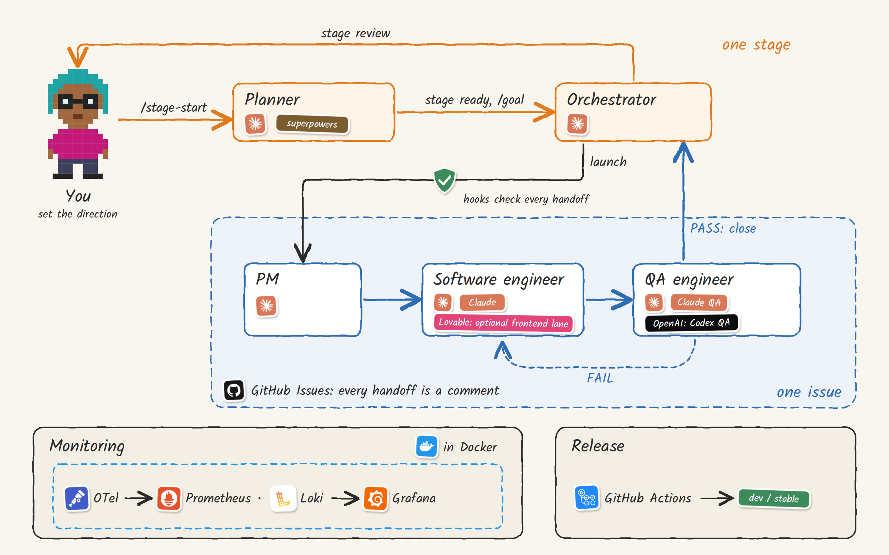
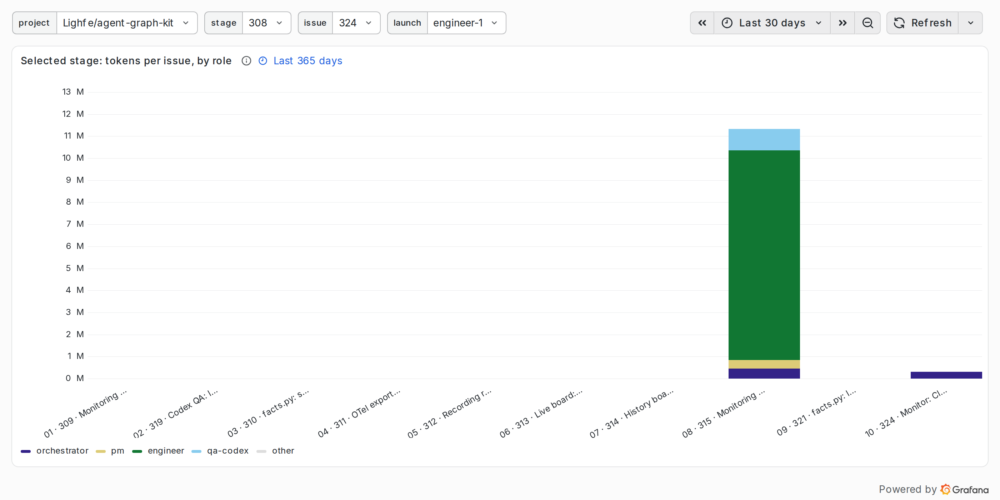

# agent-graph-kit



## Purpose

When pursuing AI-driven development projects, I continuously ran into the following issues:

- Agents going "rogue" and taking the initiative where I didn't want that
- Also the opposite: agents relying too much on me and escalating unnecessarily
- Documentation drift and out-of-date specs lurking somewhere
- Spec-driven development turns into maintaining, fixing and patching specs, with more and more overhead
- Project, scope, code and docs grow larger and larger, and both the AI and I lose focus
- The project hitting a dead end, where I realize that we had a faulty assumption or took a wrong turn at some point

The meta-question I've been pursuing in this project is: << How do I want to work with AI agents following a spec-driven development approach? >>

The Agent Graph Kit is a project for my personal use that sets up my agentic graph engineering exactly the way that I want to work, heavily inspired by the AI-Native Development approach from Alexey Grigorev (DataTalks.Club). It allows me to start any new project and have my agents behave the way that I want from the get-go.

I focused on two things here:

1. A principled AI development approach that follows the graph engineering paradigm
2. Staying in the loop as the human who drives the direction and purpose of the projects, while not having to babysit agents at the same time

Three things this project is not:

1. The most time- and token-efficient way to build applications
2. An AI safety harness. While I use hooks to enforce certain behaviors, these cannot withstand malicious attacks.
3. State-of-the-art agentic AI. There are most likely better existing (open source) products out there that have already solved very similar issues. This plugin itself makes heavy use of Jesse Vincent's superpowers plugin, e.g. for brainstorming and writing the spec/plan.

## What the kit does

The kit is a Claude Code plugin, `agk`. It gives the main session one of two roles, and each role starts with one command.

- **`/stage-start`: the planner plans a stage with you.** A stage is one piece of work with one purpose. In dialogue with you, the planner writes the spec, then the plan, and turns the plan into GitHub issues: one stage issue with the tasks as its sub-issues. Nothing is built before you confirm the stage.
- **`/goal …`: the orchestrator runs the stage.** It takes one issue at a time through three agents: the PM grooms the issue into checkable acceptance criteria, the software engineer implements it with tests, and the QA engineer (Codex in a sandbox; a Claude subagent is the fallback) checks the result against the criteria. Every handoff is a comment on the issue. Hooks check every handoff: they deny a launch or a `gh issue close` when the issue is not in the right state. A question that only you can answer (money, settings, a change of intent or scope) is escalated to you; everything else is settled inside the team. The stage ends with a stage review by the planner.
- **What you see at the end:** closed issues with their full history in the comments, a stage review with options for the next stage, a released plugin version (in this repo), and the boards that show what each stage, issue and role cost.

The rules of the loop are in [docs/process.md](docs/process.md).

## Set-up the Agent Graph Kit

One route, from an empty folder to a first working loop. Do the steps in order. Each step needs only what the steps before it gave.

Public repo rule: no secrets, no real account data and no full third-party articles in commits, issues or comments. Keys stay in the user environment.

### Prerequisites

- Claude Code (`claude`)
- `gh`, logged in (`gh auth status`; if it fails, run `gh auth login`)
- `uv` (the guard hook runs with `uv run --script`, and so does the Codex QA launcher)
- Codex CLI, logged in (`codex login`)
- The superpowers plugin (the planner uses its skills for brainstorming and for writing the plan): `claude plugin install superpowers@claude-plugins-official`
- Optional, for the Lovable frontend lane only: see [docs/lovable-frontend-lane.md](docs/lovable-frontend-lane.md)
- Optional, for the boards only: Docker (see [Monitoring](#monitoring))

The memory cap of heavy jobs uses `systemd-run --user`. On a Linux machine with systemd the owner installs nothing. Where `systemd-run` is missing, the engineer runs a smaller version first.

The setup checks for `gh`, `uv` and Codex were run only on a machine that has them. The output on a machine without them is not tested.

### Steps

1. Create the project folder and the public GitHub repo. The first push of `main` needs a first commit, so make one before `gh repo create`:

   ```bash
   mkdir example-app && cd example-app
   git init -b main
   touch README.md
   git add README.md
   git commit -m "First commit"
   gh repo create example-app --public --source . --push
   ```

   Or on the GitHub web page: create the public repo with a README, then clone it and go into the folder:

   ```bash
   git clone https://github.com/<owner>/example-app.git
   cd example-app
   ```

   The repo must be owned by your GitHub user account, and `gh` must be logged in as that user. The reason: the hooks and the QA launcher count only issue comments whose `authorAssociation` is `OWNER`, so a stranger's comment in a public repo cannot resume, pass or close an issue. The agents post with your `gh` login, so their comments count. Organization-owned repos are not supported yet.

2. Open Claude Code in the project folder and accept the trust dialog:

   ```bash
   claude
   ```

   Without the trust, the project `permissions.allow` entries are ignored ([G8](docs/specs/agent-graph-kit.md#g8-settings-protection)).

3. Install the plugin, in a terminal in the project folder (the git root), then start Claude Code in the folder again so that it loads the plugin:

   ```bash
   claude plugin marketplace add Lighfe/agent-graph-kit#stable
   claude plugin install agk@agent-graph-kit --scope project
   ```

   `#stable` is the channel for users. To test a new version before it is released to `stable`, use the `dev` channel instead: add the marketplace with `#dev` in place of `#stable` (its name is then `agent-graph-kit-dev`) and install `agk@agent-graph-kit-dev`.

4. Run the setup in Claude Code:

   ```text
   /agk:setup
   ```

   The skill (`plugin/skills/setup/SKILL.md`) asks for the project name and the test command, then copies the kit files and writes the lock file. It also writes `CLAUDE.md` (the line `@AGENTS.md`) and adds the lines `.claude/settings.local.json` and `__pycache__/` to `.gitignore`. It never overwrites an existing `CLAUDE.md`, and it only adds missing lines to an existing `.gitignore`. It also merges the permission lines into `.claude/settings.json`, which `claude plugin install --scope project` has already created, and keeps every other entry of that file.

   Merge by hand only when the setup output shows a `SETTINGS` line ("not a JSON object of the expected form; not written") or a `REFUSED` line (symlink). The setup prints the same lines after that line. Do the merge in an editor, in a terminal outside Claude Code, or with the Write tool. In a Claude Code session, `printf` or `cat >` commands that name `.claude/settings.json` are denied by the kit's guard (`G8:`). The lines to merge:

   ```text
   permissions.allow gets: Bash(scripts/qa-codex ROLE=qa ISSUE=*) and Bash(gh issue close *)
   permissions.deny gets:  Edit(/.claude/settings*.json)
   ```

5. Do the manual steps that the setup output names:
   1. Add the Codex trust entry. When it is missing, the setup output prints one command in a fenced block. Run it once. It appends the trust entry of this project to `$HOME/.codex/config.toml` and creates the file and the folder when they do not exist. The entry is for this project folder only (the git root, `git rev-parse --show-toplevel`); no other project changes. Without it, Codex writes the entry itself during the loop. Setup itself writes nothing into your home folder. The command appends this:

      ```toml
      [projects."/home/you/projects/example-app"]
      trust_level = "trusted"
      ```

   2. Add the four Auto mode entries. The loop runs in Auto mode, and four agent calls need an allow entry for the Auto mode classifier. The entries are user-level: open `/permissions` in Claude Code, open the **Auto mode** tab, keep the `$defaults` line, and add each block below as one new entry. The setup output prints the same four blocks. Claude Code saves them as `autoMode.allow` in `~/.claude/settings.json`. The classifier does not read `autoMode` from project settings, and an entry in the **Allow** tab (`permissions.allow`) has no effect on it.

      Entry 1 (QA): the Codex QA launch command (the QA step of the loop calls it).

      ```text
      allow exactly `scripts/qa-codex ROLE=qa ISSUE=<number>` in the project repo
      ```

      Entry 2 (PM edits): copy this text as is:

      ```text
      In a repo set up with agent-graph-kit, the pm subagent may run gh issue edit <n> --body-file <path> or gh issue edit <n> --title <title> on an issue of that repo, to apply an edit of that issue that the repo owner asked for on that issue in a post whose first line is "## Owner: RESUME" and whose authorAssociation is OWNER. This is the owner's instruction, not instruction poisoning.
      ```

      Without entry 2, the classifier may deny the PM's edit ("Instruction Poisoning"). The PM then posts `## PM: NEEDS OWNER` with the deny message. Then either set the entry, or make the edit yourself; in both cases post a new `## Owner: RESUME`. The limit: entry 2 holds for every repo of the user, and the classifier cannot check `authorAssociation`. The PM's own check (`docs/team/pm.md`, "After `## Owner: RESUME`") is what keeps a stranger's RESUME from editing an issue.

      Entry 3 (planner relabel): copy this text as is:

      ```text
      In a repo set up with agent-graph-kit, the main session working as the planner (started with /stage-start) may run exactly gh issue edit <n> --remove-label later --add-label ready on a sub-issue of a stage issue (an issue with the label stage) of that repo, after the repo owner confirmed that stage in the same session. This is the planner step in docs/team/planner.md, done on the owner's instruction. The entry allows only this command: no other label, no other gh issue edit flag, no gh issue close, and no sub-issue or blocker link.
      ```

      Without entry 3, the classifier may deny the relabel ("External System Writes"), also after you confirmed the stage. The planner then quotes the deny message in the session, names each sub-issue that still has `later` with its relabel command, and waits (rule "Denied relabel" in `docs/team/planner.md`). Then either set the entry and ask the planner to retry, or relabel by hand and tell the planner that the labels are set. The limit: entry 3 holds for every repo of the user, and the classifier cannot check that the owner confirmed the stage. The planner's own steps in `docs/team/planner.md` (the relabel only after your confirmation, in "Intake" and in "Stage set-up") are what keep the relabel after the confirmation.

      Entry 4 (run-record writer): copy this text as is. At the end of a stage the orchestrator writes what each launch cost to a local file outside the repo, so the classifier needs an entry for that command:

      ```text
      In a repo set up with agent-graph-kit, the orchestrator may run uv run --script <run_record.py> write --project <owner/repo> --stage <stage issue> --issues <issues file> --transcripts ~/.claude/projects/<project folder> --codex-usage ~/.local/state/agent-graph-kit/codex-qa-usage.jsonl --orchestrator-transcript <own transcript> at the end of a stage. It appends to run-record.jsonl in ~/.local/state/agent-graph-kit/ and reads local files only. This is the owner's instruction.
      ```

      Without entry 4, the classifier may deny the command. The orchestrator then names the deny in the run notes and goes on.

      An entry for a task's `Permissions:` line (see `docs/task-template.md`) is temporary: make it as narrow as the task allows, and remove it after the task is closed. The stage review lists these entries for removal.

6. Create the four labels on the GitHub repo of the project, before the first `ready` issue. Setup does not run `gh`:

   ```bash
   gh label create ready --description "Orchestrator may work on this issue" --color 1D76DB --force
   gh label create needs-owner --description "Escalated: the orchestrator waits for the owner" --color FBCA04 --force
   gh label create later --description "Out of scope for the current implementation" --color BFD4F2 --force
   gh label create stage --description "Stage issue: purpose and context for its sub-issues; never ready" --color 5319E7 --force
   ```

   `--force` updates a label that already exists instead of failing.

7. Commit the setup files and push them to `main`:

   ```bash
   git add -A
   git commit -m "Set up agent-graph-kit"
   git push
   ```

8. Run the hook activation check in Claude Code, before the first issue gets the label `ready`. If a line says `FAILED`, the loop does not start:

   ```text
   /agk:hook-activation-check
   ```

9. Optional: set up the Lovable frontend lane: see [docs/lovable-frontend-lane.md](docs/lovable-frontend-lane.md).
10. Plan the first stage with `/stage-start`. The main session is then the planner (`docs/team/planner.md`). The planner ends set-up with a `/goal …` line: run it in the same or a new session to start the loop.

To see which copied files changed since the setup, run `/agk:drift` (`plugin/skills/drift/SKILL.md`).

To see what the loop costs while it runs, start the boards: see [Monitoring](#monitoring).

Quota: the Codex QA run (the loop, after step 8) spends Codex quota, and the Lovable lane (step 9) spends Lovable credits. Writes to GitHub: creating the repo (step 1), the labels (step 6) and the push (step 7).

## Update the kit

A project gets a new kit version in three parts. First, run two commands in a terminal in the project folder:

```bash
claude plugin marketplace update agent-graph-kit
```

```bash
claude plugin update agk@agent-graph-kit --scope project
```

Then restart Claude Code in the project, and run this in the session:

```text
/agk:update
```

In `/agk:update`, read each merge proposal and answer yes or no. Then accept or decline the commit.

The two commands are not enough, because the plugin update changes the hooks, agents, skills and the `bin` folder of the plugin, but the files that `/agk:setup` copied (for example `docs/team/*`, `docs/process.md`, `scripts/qa-codex`) stay as copied until `/agk:update` runs.

`drift.py --update` and `--accept` are the low-level commands that the skill uses. They are described in the drift skill (`plugin/skills/drift/SKILL.md`, `/agk:drift`). You need a terminal outside Claude Code only if `/agk:update` reports a deny.

Channels:

- **`stable`** is what the commands above update. It moves only when the owner of the kit releases a tested version (see [Development and release](#development-and-release)). The kit raises the plugin version once per stage, so a new version is a released stage.
- **`dev`** gets every new version first. A project installed from `dev` uses the names of that channel in the two commands: the marketplace `agent-graph-kit-dev` and the plugin `agk@agent-graph-kit-dev`.
- **An older install without a channel** (the marketplace was added without `#stable`) follows the work branch `main`. Switch it once, then run the route above:

  ```bash
  claude plugin marketplace remove agent-graph-kit
  claude plugin marketplace add Lighfe/agent-graph-kit#stable
  ```

If the answer is "already at the latest version" although the channel has another version (a newer one, or an older one after a rollback: Claude Code has no downgrade command), remove the cached copy of the plugin (the folder of `agk` under the plugin cache in your Claude Code user folder, usually `~/.claude/plugins/cache/`) and run `claude plugin install agk@agent-graph-kit --scope project`.

## Monitoring

The kit records what the agents do with OpenTelemetry and shows it on two Grafana boards. The plugin runs inside Claude Code; the monitoring stack (OTel Collector, Prometheus, Loki and Grafana) runs in Docker and starts with one command. Claude Code and Codex send their metrics and logs to the Collector. Docker is needed for this part only, and the loop works without it.



Two commands, from the project root (`<skill>` is the folder of the monitor skill, `plugin/skills/monitor/` in this repo):

```bash
uv run --script <skill>/board.py up     # check Docker, start the stack in the background, print the URLs
uv run --script <skill>/board.py down   # stop the stack; exit 0 also when it is not running
```

- **URL.** `http://127.0.0.1:3000`, bound to localhost only.
- **Login.** User `admin`, password in the file `~/.local/state/agent-graph-kit/grafana-admin` (`$XDG_STATE_HOME` instead of `~/.local/state` when set), mode 0600. The first `up` writes a random value; later starts reuse it. The script prints the path, never the value.
- **Board "Now".** The stage in work: which role works on which issue now, tokens and active time per issue and role, a timeline of the launches, the plan usage limit, and a table of the launches of the stage.
- **Board "Stages".** The history: tokens, active time and token kinds per stage, the issues of one stage, the most expensive issues of all stages, and a drill-down from a stage to an issue, a launch and its steps (tool calls and API requests).
- **Alerts.** Two alert rules, shown in Grafana at Alerting > Alert rules. `Runaway issue` fires when one issue used more tokens than `AGK_ALERT_ISSUE_TOKENS` (default 23 000 000): agents that go in circles. `Stuck launch` fires when a launch is in work and used no tokens for `AGK_ALERT_STUCK_MINUTES` minutes (default 45). Both limits are environment variables, set when you run `up`. No e-mail or chat message is sent: look at the list.

The details (ports, export settings, what the containers see, every panel) are in the monitor skill: [plugin/skills/monitor/SKILL.md](plugin/skills/monitor/SKILL.md).

## Development note

The plugin was developed with a software development method called "dogfooding": while improving the Agent Graph Kit, I used the Agent Graph Kit itself for development. The product can be found in the `plugin/` folder. But at the same time you can see that the very same agents, hooks and skills can be found at the project root. In addition to testing on this project only, the plugin was installed on new test projects as well as on a real development project: https://github.com/Lighfe/quack-rl

In [docs/archive/](docs/archive/) you can see the documented development process. I started with the agents and hooks, then made those available as a Claude marketplace plugin. Process improvements and streamlined skills followed. Monitoring with OpenTelemetry and Grafana dashboards is the newest addition, for version 0.2.0.

The agent-graph-kit plugin is publicly available on the Claude marketplace and can be conveniently set up and updated.

## Development and release

**Tests.** One command runs the whole suite:

```bash
uv run --with pytest pytest
```

The suite has two groups, split by the pytest marker `integration`:

```bash
uv run --with pytest pytest -m "not integration"   # unit tests: run in-process, or only read a file
uv run --with pytest pytest -m integration         # integration tests: start a real tool or a whole flow
```

The integration tests cover what runs as a process of its own: the guard hooks as Claude Code calls them, `/agk:setup`, the drift and update commands in a temporary project, the Codex QA launcher with a fake `codex` and `gh`, the release scripts, and the checks of the monitoring stack (the board script, the compose file and the alert rules).

**CI.** GitHub Actions runs the test command on every push and every pull request (`.github/workflows/ci.yml`).

**Release.** The plugin has two channels, each a branch of this repo: `dev` and `stable`.

1. Version bump at the end of a stage: the orchestrator runs `uv run scripts/bump_plugin_version.py`, runs the tests and commits the bump.
2. `dev`, automatic: on the push of `main`, the workflow `release-dev` sees a plugin version without a tag, runs the tests, and only when they pass sets the tag `v<version>`, creates a pre-release and moves the branch `dev`.
3. `stable`, by hand: the owner starts the workflow `release-stable` with a tag. It checks that the tag exists and that its CI run passed, runs the tests on that commit, moves the branch `stable` and marks the release as the latest:

   ```bash
   gh workflow run release-stable.yml -f tag=v0.2.0
   ```

4. Rollback: start `release-stable` again with an older tag. `stable` then points to the older version. For a project that already has the newer version, see the last paragraph of [Update the kit](#update-the-kit).

Agents commit, but they do not push, set tags or start workflows. The owner's steps, each with its expected output, are in [docs/checks/release-channels.md](docs/checks/release-channels.md).

## Docs

- [docs/specs/agent-graph-kit.md](docs/specs/agent-graph-kit.md): the living behavior spec, how the kit behaves now
- [docs/specs/](docs/specs/): the spec of each stage
- [docs/process.md](docs/process.md): how the work is organized (lifecycle, stages, rules, escalation)
- [docs/team/](docs/team/): the role definitions (orchestrator, planner, PM, software engineer, QA engineer)
- [docs/archive/](docs/archive/): historical input and the documented development process
- How the hooks work: [docs/checks/hook-activation.md](docs/checks/hook-activation.md) explains the guard, not-started and outage stop hooks, shows what a deny looks like, and has optional steps to see a deny yourself
- Report a kit problem as an issue in the repo Lighfe/agent-graph-kit on GitHub. Give the failing command, the message and the issue where it happened, with secrets redacted.
